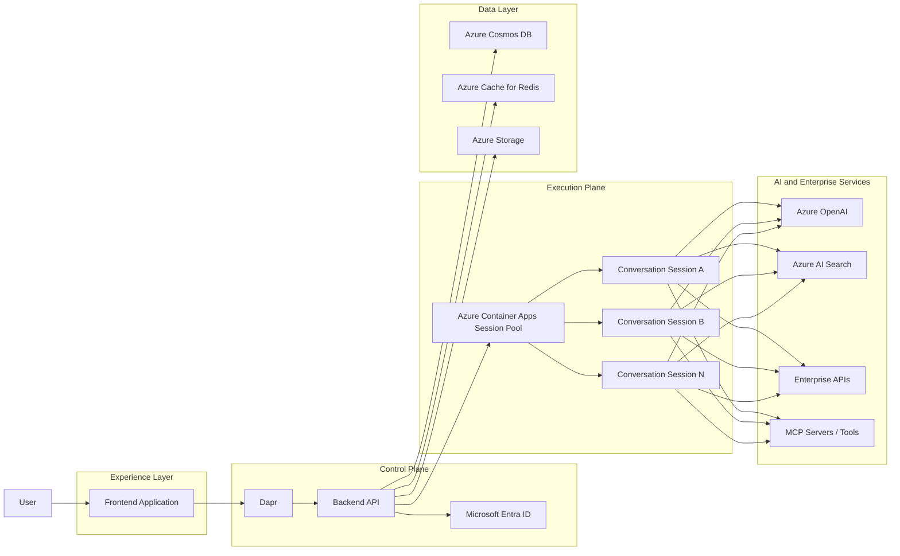

# Architecting AI Agents with Azure Container Apps Session Pools

## Executive Summary

Azure Container Apps Session Pools provide a specialized execution model for workloads that require isolated, short-lived, and rapidly available runtime environments.

For AI agent platforms, the primary architectural value is not container hosting itself, but the ability to separate:

- Application orchestration from agent execution.
- Business state from runtime state.
- Identity and governance from workload processing.
- Persistent storage from ephemeral compute resources.

A well-designed architecture treats Session Pools as an execution fabric for AI agents while maintaining application ownership, security, session management, and state persistence within a centralized backend service.

This approach enables scalable, secure, and operationally efficient AI solutions while preserving clear security and ownership boundaries.

---

# Architecture Overview

The architecture consists of four logical layers:

1. **Experience Layer**: User-facing applications and interfaces.
2. **Control Plane**: Backend services responsible for orchestration and governance.
3. **Execution Plane**: Session Pool-hosted AI agents.
4. **Data and AI Services Layer**: Persistent storage, models, and enterprise systems.

---

# Architecture Principles

## Principle 1: Separate the Control Plane from the Execution Plane

The backend represents the system's control plane and remains responsible for all governance and ownership concerns.

### Control Plane Responsibilities

- Authentication and authorization
- Session lifecycle management
- Conversation ownership
- Policy enforcement
- Auditing and compliance
- Persistent state management
- Observability and monitoring
- Cost governance

### Execution Plane Responsibilities

- Prompt execution
- Model interaction
- Tool invocation
- Temporary workload processing
- Context execution

By clearly separating these responsibilities, business-critical functions remain independent from transient execution environments.

---

## Principle 2: Treat Sessions as Ephemeral Compute

Session Pools should be considered disposable execution environments.

A session may be created, terminated, replaced, or scaled without affecting application continuity.

The following information should never depend on session lifetime:

- Conversation history
- User profile data
- Business transactions
- Uploaded files
- Long-term memory
- Audit records
- Workflow checkpoints

Instead, durable information should be stored in managed persistence services.

### Recommended Persistence Services

| Requirement | Azure Service |
|------------|---------------|
| Conversation Storage | Azure Cosmos DB |
| Transactional Data | Azure SQL Database |
| Object Storage | Azure Storage Accounts |
| Caching | Azure Cache for Redis |
| Retrieval-Augmented Generation (RAG) | Azure AI Search or Vector Databases |

This design enables session replacement without data loss.

---

## Principle 3: Establish Strong Isolation Boundaries

AI agents frequently process untrusted prompts, execute tools, invoke enterprise APIs, and interact with external systems.

Isolation therefore becomes a foundational architectural requirement.

### Recommended Isolation Model

**One Session per Conversation**

Benefits include:

- Predictable ownership boundaries
- Simplified troubleshooting
- Improved auditability
- Reduced blast radius
- Better resource isolation
- Easier lifecycle management

This mapping is an architectural recommendation rather than a platform requirement.

Alternative models may be appropriate for batch processing, orchestrated workflows, or high-throughput agent scenarios.

---

## Principle 4: Implement Zero-Trust Security

Session containers must not be implicitly trusted.

Every interaction should be authenticated, authorized, and constrained according to the Principle of Least Privilege.

### Recommended Security Controls

#### Identity

- Use Managed Identities whenever possible.
- Avoid embedded credentials.
- Avoid long-lived secrets.

#### Authorization

Backend services should receive:

- **Azure Container Apps Session Executor** role.

Execution environments should receive only:

- Access strictly required for workload execution.

#### Secrets Management

Store secrets in:

- Azure Key Vault

Avoid:

- Environment-variable secrets when possible.
- Credentials embedded in container images.
- Credentials generated within sessions.

#### Network Security

Consider:

- Private Endpoints
- Virtual Networks
- Network Security Groups
- Outbound traffic restrictions

The execution environment should only reach explicitly approved services.

---

# Session Lifecycle Management

## Session Creation

The backend generates and controls session identifiers.

Clients should never directly provide or control session identifiers.

Benefits include:

- Consistent ownership enforcement
- Session hijacking protection
- Improved governance
- Simplified auditing

## Session Discovery

The backend is responsible for locating the appropriate execution session and routing requests accordingly.

## Session Termination

Session expiration should be managed through idle timeout policies and operational requirements rather than application state requirements.

A terminated session must not result in business-state loss.

---

# Network and Connectivity Design

AI agent workloads commonly require access to external dependencies.

Typical dependencies include:

- Azure OpenAI
- Azure AI Search
- Cosmos DB
- Microsoft Graph
- Internal enterprise APIs
- MCP Servers
- SaaS platforms
- Monitoring systems

Network requirements should be identified during architectural design rather than during deployment.

A significant percentage of production issues originate from overlooked connectivity requirements rather than application logic.

---

# Scaling Strategy

Session Pools introduce a balance between user experience, throughput, and infrastructure cost.

## Warm Capacity

Pre-warmed sessions reduce cold-start latency.

Typical starting recommendations:

| Environment | Warm Sessions |
|------------|--------------|
| Development | 0–1 |
| Pilot | 1–3 |
| Production | Based on observed baseline traffic |

## Concurrency

Concurrency planning should consider:

- Average session duration
- Tool execution time
- Model response latency
- User arrival patterns
- Peak utilization windows

Capacity planning should be telemetry-driven.

## Idle Timeout

Recommended starting values:

| Workload Pattern | Idle Timeout |
|-----------------|-------------|
| Interactive Chat | 5 Minutes |
| Copilot Experiences | 10–15 Minutes |
| Long Running Agents | 15–30 Minutes |

Values should evolve based on usage analytics and cost objectives.

---

# Observability and Operational Excellence

Production implementations should include full-stack observability.

### Recommended Azure Services

- Azure Monitor
- Application Insights
- Log Analytics Workspace
- Azure Cost Management
- Managed Grafana (optional)

### Key Metrics

Infrastructure Metrics:

- Session creation latency
- Cold-start frequency
- Pool utilization
- Session reuse ratio
- Active session count

Application Metrics:

- Conversation latency
- Prompt execution duration
- Tool invocation duration
- Model response time
- Failed executions

Business Metrics:

- Cost per conversation
- Cost per successful task
- User satisfaction indicators
- Agent task completion rate

Operational decisions should be based on observed telemetry rather than static configuration assumptions.

---

# Reference Deployment Recommendations

## Pilot Phase

Recommended starting configuration:

| Setting | Value |
|----------|--------|
| Session Mapping | One Session per Conversation |
| Warm Sessions | 1 |
| Concurrency | Limited |
| Idle Timeout | 5 Minutes |
| Identity | Managed Identity |
| Secrets | Azure Key Vault |
| Monitoring | Application Insights + Log Analytics |

The objective during this phase is validation of latency, user experience, reliability, and operating costs.

## Production Phase

Scaling decisions should be based on:

- Peak demand characteristics
- User concurrency
- Startup latency targets
- Cost optimization goals
- Service-level objectives (SLOs)

No fixed configuration is universally optimal.

---

# Design Intent

Azure Container Apps Session Pools should not be viewed as a mechanism for hosting Docker containers.

They are best understood as an execution layer specifically optimized for:

- AI agents
- Sandboxed workloads
- Tool-enabled agents
- Dynamic runtime allocation
- Isolated execution environments

The architecture delivers value through clear separation between orchestration, security, state management, and execution.

Organizations building enterprise AI platforms should design Session Pools as an elastic execution substrate while retaining ownership of identity, governance, and data within the control plane.

---

# Key Takeaways

✅ Maintain a strict separation between the control plane and execution plane.

✅ Treat Session Pools as ephemeral compute resources.

✅ Store all durable state outside session containers.

✅ Use Managed Identity and the Azure Container Apps Session Executor role.

✅ Prefer one session per conversation for strong isolation.

✅ Design security boundaries according to Zero-Trust principles.

✅ Drive scaling decisions using telemetry and operational data.

✅ View Session Pools as an AI execution fabric, not as a generic container hosting platform.